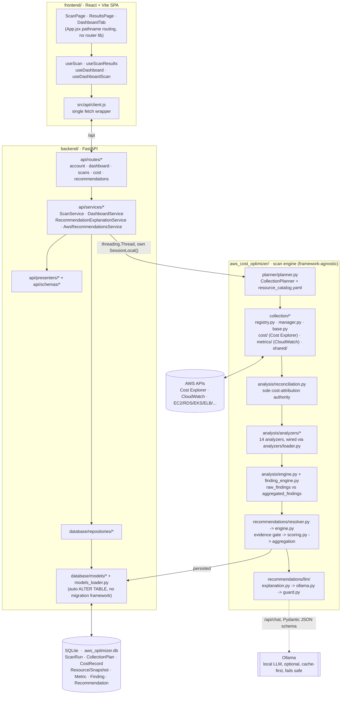
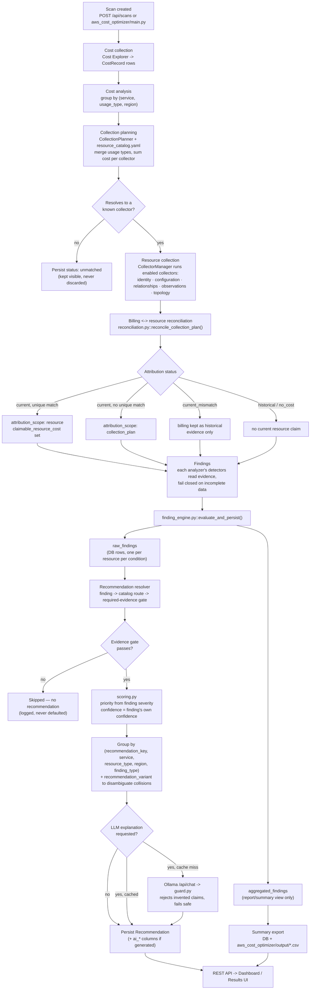

# AWS Cost Optimizer — Architecture and Design Rationale

This document explains *why* the system is built the way it is, not just
what files exist. Code-level specifics (exact paths, function names,
line-level contracts) live in `CLAUDE.md`; this document is the narrative
that connects them.

## Table of Contents

1. [Problem Definition](#01-problem-definition)
2. [AWS Cost Optimization Principles](#02-aws-cost-optimization-principles)
3. [System Architecture](#03-system-architecture)
4. [Data Flow](#04-data-flow)
5. [Cost-Driven Collection](#05-cost-driven-collection)
6. [Evidence Model](#06-evidence-model)
7. [Billing Reconciliation](#07-billing-reconciliation)
8. [Analyzer Architecture](#08-analyzer-architecture)
9. [Finding Model](#09-finding-model)
10. [Recommendation Engine](#10-recommendation-engine)
11. [Validation Plans](#11-validation-plans)
12. [LLM Explanation Layer](#12-llm-explanation-layer)
13. [Safety and Hallucination Control](#13-safety-and-hallucination-control)
14. [API](#14-api)
15. [Dashboard](#15-dashboard)
16. [Database](#16-database)
17. [Testing](#17-testing)
18. [Limitations](#18-limitations)
19. [Results](#19-results)
20. [Future Work](#20-future-work)

---

## 01. Problem Definition

AWS bills are itemized by **usage type** ("EU-NatGateway-Hours",
"EU-InstanceUsage:db.r6g.large"), not by "this specific resource cost you
this much." Cost Explorer can tell you *that* NAT Gateway hours cost
$126.91 this month across a region; it cannot tell you *which* NAT
Gateway, or whether that gateway is even doing anything useful.

Two failure modes dominate naive cost-optimization tooling, and this
project exists specifically to avoid both:

1. **Overclaiming.** Assuming a shared or historical billing line belongs
   to one specific, currently-existing resource, then recommending an
   action ("delete this," "resize that") backed by a dollar figure that
   isn't actually proven. This is the single most dangerous failure mode
   for a tool whose recommendations a human might act on — a wrong
   $200/month "guaranteed savings" claim is worse than no claim at all.
2. **Silence-as-zero.** Treating missing telemetry (a CloudWatch metric
   with no datapoints, a collector that hit an API error, a resource type
   that couldn't be fully discovered) as if it were a *confirmed* zero.
   "No data" and "confirmed zero usage" are different facts and must
   produce different conclusions.

The project's design is best summarized as: **collect only what's needed
to explain the money that's actually being spent, then never say more
than the evidence supports.**

## 02. AWS Cost Optimization Principles

These are the non-negotiable rules the rest of the system is built to
enforce, established and re-validated repeatedly over the project's
history (several were the direct result of catching a real bug and then
writing a regression test to pin the fix permanently):

- **Missing evidence is not zero, and it is not a negative observation.**
  A CloudWatch metric with no datapoints means "unknown," not "idle." A
  collector that couldn't be run means "we don't know," not "nothing
  found." This shows up throughout the codebase as explicit three-state
  logic (`observed=True` / `observed=False` / `unknown`) rather than a
  boolean.
- **A cost figure needs proof of attribution, not just proximity.**
  Cost Explorer's billing line for a usage type is not automatically "this
  resource's cost" just because a resource of that type exists. Attribution
  requires either a unique, complete match (exactly one resource of that
  type currently exists) or an explicit identity derived from the usage
  type itself (e.g. an RDS instance class parsed out of
  `InstanceUsage:db.r6g.large`). See [§07](#07-billing-reconciliation).
- **A finding is not a recommendation, and a recommendation is not an
  executed action.** Each step up that chain requires *more* evidence and
  *more* caution, never less. A finding says "this condition is present."
  A recommendation says "here is a controlled procedure to evaluate
  whether to act on it." Neither says "this has been done" or "this is
  guaranteed safe."
- **Never invent what the evidence doesn't contain.** No fabricated
  instance types, no invented dependency-free guarantees, no assumed
  business justification, no manufactured savings percentages. This rule
  is enforced mechanically (see [§13](#13-safety-and-hallucination-control)),
  not just by convention.
- **Collect for a reason, not exhaustively.** The system does not crawl
  every AWS API by default; the collection planner decides what to collect
  based on where the money in Cost Explorer actually is
  ([§05](#05-cost-driven-collection)). Adding a collector that gathers data
  nothing downstream uses is treated as a design smell, not a feature.
- **Historical billing and current infrastructure are different worlds,
  and must never be silently merged.** A deleted RDS instance's historical
  cost must never be presented as if it belongs to a *different*,
  currently-running instance just because they're the same resource type.

## 03. System Architecture

The project has three independently runnable parts:

```
aws_cost_optimizer/   Python scan engine — collection, analysis, findings,
                      recommendations. No web framework dependency; can run
                      standalone via aws_cost_optimizer/main.py.
backend/              FastAPI application. Wraps the engine, persists scan
                      results to SQLite, serves the REST API the frontend
                      consumes. Scans run as background threads.
frontend/             React + Vite single-page app. Drives scans and
                      renders dashboards/results by calling the backend API.
```

The scan engine is deliberately framework-agnostic: `aws_cost_optimizer/`
has no FastAPI or SQLAlchemy imports. `backend/` depends on it, never the
reverse. This means the same pipeline that runs inside the API's
background threads (`backend/api/services/scan_service.py`) can also run
as a bare CLI script (`aws_cost_optimizer/main.py`) against the exact same
code paths — there is no "test path" vs. "real path" split to drift apart.

A recurring gotcha this split creates: `aws_cost_optimizer/` uses bare
top-level imports (`from collection.registry import ...`), which only
resolve when `aws_cost_optimizer/` itself is on `sys.path`.
`backend/bootstrap.py::ensure_project_paths()` inserts both the repo root
and `aws_cost_optimizer/` onto `sys.path`, and every entry point calls it
before any other project import.



## 04. Data Flow

The full pipeline, in the order a scan actually executes it:

```
Cost Explorer (AWS Cost & Usage)
        │
        ▼
Collection Planner            -- decide WHAT to collect, from WHERE the
        │                        money in this scan's billing data is
        ▼
Resource Catalog resolution   -- billing (service, usage_type) -> which
        │                        collector/resource_type owns this cost
        ▼
Collectors (per resource type)  -- identity, configuration, relationships,
        │                          CloudWatch observations, topology
        ▼
Billing ↔ Resource Reconciliation  -- can this billing line's dollar
        │                             amount be attributed to a specific
        │                             currently-discovered resource?
        ▼
Analyzers                     -- evidence -> Finding, one per resource
        │                        per detected condition
        ▼
Finding Aggregator            -- raw findings (DB) vs. aggregated view
        │                        (reporting) -- kept deliberately separate
        ▼
Recommendation Engine         -- eligible finding -> catalog route ->
        │                        evidence gate -> recommendation, then
        │                        grouped by (route, finding_type)
        ▼
(optional) LLM Explanation    -- explains an already-decided recommendation
        │
        ▼
Persistence (SQLite) → REST API → Dashboard / Results UI
```

Two things are intentionally **not** on this list because they were
explicitly rejected as design choices: there is no step where an LLM
decides *whether* something is a problem, and there is no step where a
recommendation's dollar figure is estimated independently of what
reconciliation already proved.



## 05. Cost-Driven Collection

`aws_cost_optimizer/planner/planner.py::CollectionPlanner` is the entry
point for "what do we actually go collect." It groups the scan's Cost
Explorer records by `(service, usage_type, region)`, sums cost per group,
and resolves each group through `resource_catalog.yaml` to decide which
collector owns that billing pattern.

A resource type's cost is often split across multiple usage types that
all belong to the same collector — NAT Gateway hours and NAT Gateway
bytes-processed are two separate Cost Explorer line items but one
`nat_gateway` collector. The planner aggregates these fully in memory,
**summing** the cost across every merged usage type, before persisting one
`CollectionPlan` row per `(collector, region, resource_type)` — a design
correction made after discovering the earlier version silently dropped
every usage-type line except the single largest one, undercounting the
resource type's true billed cost whenever it spanned more than one line
item.

Billing that doesn't resolve to any known collector isn't discarded — it's
persisted with `status: "unmatched"`, so a genuinely unrecognized cost
driver stays visible instead of vanishing silently. Zero-cost billing is
allowed to still trigger collection (`cost_threshold` is not a
correctness gate); it only ever means one extra collector call for
negligible-cost evidence, never a fabricated financial claim.

`resource_catalog.yaml` also holds the collector/analyzer wiring: given a
resource type, which Python module implements its collector, and which
implements its analyzer. This wiring is config-driven specifically so a
new resource type can be added by writing a collector, writing an
analyzer, and adding one catalog entry — no import list to maintain by
hand.

## 06. Evidence Model

Every collector produces a consistent evidence shape for its resource
type, split into fixed sections: **identity** (IDs, names, ARNs),
**configuration** (the resource's own settings), **relationships**
(what it's attached to / depends on), **observations** (CloudWatch
metrics), and **topology** (network/routing context where relevant).
`aws_cost_optimizer/planner/collection_profile.py::CollectionProfile`
enforces that every resource type's profile actually declares all five
sections — a validation gap here used to accept a profile missing every
one of them silently; it now raises at load time, matching the same
"fail loudly on wiring gaps" principle used for the collector/analyzer
registries.

CloudWatch metric evidence is never collapsed to a bare number. A metric
summary always carries `has_data`/`observed` alongside the value, and
carries the CloudWatch `statistic` it was computed with (`Sum`, `Average`,
`Maximum`) so an analyzer can refuse to use it if the statistic doesn't
match what the calculation requires. `aws_cost_optimizer/analysis/
metrics.py` is the single, shared module every analyzer uses for this —
`metric_has_observed_data()`, `metric_is_zero()`, `metric_sum_value()`, and
friends are the only sanctioned way to read a metric's value, precisely so
"missing ≠ zero" can't be reintroduced accidentally in a new analyzer.

A concrete bug this discipline caught: `CloudWatchMetricCollector` was
deliberately never given a way to compute a real "coverage percentage"
(sparse AWS metrics legitimately have gaps that don't mean anything), but
five analyzers were separately gating their detectors on that
never-populated field being numeric — a dead gate that silently disabled
detectors for the ELB, Aurora, RDS, DynamoDB, and EKS analyzers for as
long as it existed. The fix was to gate on `metric_has_observed_data()`
instead everywhere, matching the pattern the NAT/WAF/TGW analyzers already
used correctly.

## 07. Billing Reconciliation

`aws_cost_optimizer/analysis/reconciliation.py::reconcile_collection_plan()`
is the single authority for turning "a billing line exists" and "these
resources were discovered" into an attribution verdict. No analyzer is
allowed to re-derive this — they read `context.billing()` and pass it
through untouched.

The output is one of a small set of states, each with a distinct meaning
that downstream code is required to respect:

| Status | Meaning |
|---|---|
| `current` | Resources exist now; billing may or may not be resource-attributable (see below). |
| `current_mismatch` | Resources of this type exist, but none match the identity the usage type implies (e.g. billing says `db.t3.large`, discovery only finds `db.r6g.large`). Billing is retained as historical evidence, never presented as the current resource's cost. |
| `historical` | Billing exists; no current resource of this type was discovered at all (a deleted RDS instance, an EKS cluster torn down mid-month). |
| `no_cost` | No positive billing amount for this plan. |

Within `current`, whether a dollar figure may be attributed to one
*specific* resource — `attribution_scope: "resource"`,
`claimable_resource_cost` non-null — depends on proof, not proximity:
either the usage type encodes a real identity (an RDS instance class
parsed via regex) that matches exactly one discovered resource, **or**
there is exactly one resource of that type in the region and discovery
was complete (in which case the billing line mathematically has nowhere
else to go). Anything short of that stays `attribution_scope:
"collection_plan"` — a real, non-null cost, but explicitly not claimable
by any single resource. This distinction is what stops, for example,
three NAT gateways sharing one region-level `NatGateway-Hours` charge from
each claiming the *entire* charge as their own eliminable cost.

## 08. Analyzer Architecture

An analyzer's job is narrow and mechanical by design: read a resource's
evidence, and for each of its detector rules, decide "does this specific
condition hold, given complete evidence, or not." Every analyzer in this
project follows the same shape:

```python
def analyze(self, context) -> list[Finding]:
    if not self.supports(context):
        return []
    evidence = context.optimization_evidence()
    findings = []
    for detector in (self._check_a, self._check_b, ...):
        try:
            finding = detector(context, evidence)
        except Exception as exc:
            log(...); continue   # one bad detector never aborts the others
        if finding is not None:
            findings.append(finding)
    return findings
```

Each `_check_*` detector fails closed: if the evidence it needs is
incomplete, it returns `None` rather than guessing. This is the pattern
behind, for instance, the NAT Gateway analyzer's idle detector requiring
*all four* core traffic byte metrics plus `ActiveConnectionCount` to be
individually complete and confirmed-zero before it will call a gateway
idle — a single missing metric among those five degrades the outcome to a
separate `telemetry_incomplete` finding, never a false idle claim.

A design rule enforced repeatedly across analyzers: **diagnostic evidence
never defines activity.** NAT Gateway's `IdleTimeoutCount`,
`ErrorPortAllocation`, and `PacketsDropCount` are real signals worth
surfacing, but they are historical/event counters — a burst of idle
timeout events last week does not mean the gateway has active connections
right now, so the idle detector explicitly excludes them from its
activity determination and reports them as a separate, clearly-labeled
diagnostic finding instead.

## 09. Finding Model

A `Finding` (`aws_cost_optimizer/analysis/finding.py`) is always
resource-level and raw: one row per affected resource per detected
condition, never merged or deduplicated at this layer. Three NAT gateways
being idle is three `Finding` rows in the database, even though the UI
may present them as one aggregated item.

That "may present as one" is handled by a **separate** component,
`FindingAggregator`, deliberately kept apart from the raw findings: it
decides whether a report groups findings per-resource, per-region, or
per-service for *display*, without ever touching the underlying raw rows.
The recommendation engine is required to consume the raw findings, never
this aggregated view — feeding the aggregated view into the recommendation
engine was a real historical bug, now guarded against structurally by
keeping the two code paths (`raw_findings` / `aggregated_findings`)
explicitly distinct outputs of `finding_engine.py::evaluate_and_persist()`.

A `Finding` carries a `cost_optimization_type` (`review`, `rightsizing`,
`elimination`, `configuration`, `commitment`, `architecture`) that gates
what kind of savings claim is even possible for it later —
`"elimination"` is the *only* type that permits claiming a resource's
full cost as recoverable savings, and only 9 of roughly 109 finding types
across every analyzer use it (the ones that genuinely mean "this resource
can be fully removed": an idle NAT gateway, an unassociated Elastic IP, an
unattached EBS volume, an idle ELB with cost, and similar). Every other
finding type — rightsizing, underutilization, anything not
resource-exclusive — reports `estimated_monthly_savings: null` with an
explanatory basis instead of a number. This was a deliberate, tested
decision, not an oversight: a prior financial-value-weighted approach was
tried, found to invite exactly the overclaiming this project exists to
avoid, and explicitly removed.

## 10. Recommendation Engine

`aws_cost_optimizer/recommendations/engine.py::RecommendationEngine`
builds one recommendation per eligible finding, then groups matching ones
together. The grouping key is `(recommendation_key, service, resource_type,
region, finding_type)` — `finding_type` is deliberately part of the key,
because two different finding_types on the very same resource represent
two different conditions with two different pieces of evidence, and
merging them would mean one recommendation silently presenting only one
finding's specific reasoning as if it covered both. Findings that share
every part of that key — the common case is the same finding_type across
several resources, e.g. three idle NAT gateways — collapse into one
recommendation whose `affected_resources` and `source_finding_ids` list
every member.

There is deliberately no catalog-level flag controlling this (an earlier
version had one; it was removed). Grouping falls out entirely from the
key above, which also correctly explains why account-level commitment
recommendations (Savings Plans, Reserved Instances) still aggregate across
every eligible resource in the account with no special case needed: their
`recommendation_scope: account` makes every member resolve to the
identical `account:<id>` persistence scope regardless of resource or
finding_type, so they were never really "aggregated by a flag" — they
aggregate because their scope already says they should.

The persisted identity for a merged group needs care: if two different
finding_type groups land on the same resource, they'd naturally want to
persist under the identical `(recommendation_key, resource_type, scope)`
tuple and collide on the database's unique constraint (this happened once,
in production: an idle-ELB finding merged with three other ELB findings on
the same load balancer, and the constraint collision let an arbitrary
low-severity member silently overwrite a high-severity one). The fix uses
`recommendation_variant` — a column that existed end-to-end already but
was always `None` — set to the group's finding_type, which disambiguates
exactly the cases that would otherwise collide.

**Priority is the finding's own severity**, not a catalog-static value —
`scoring.py` only falls back to the catalog's default priority when a
finding has no valid severity at all, with a documented, tested cost-based
escalation of at most one tier in either direction. Confidence is never
blended into priority; it stays the finding's own confidence, used only as
a tiebreaker.

## 11. Validation Plans

Every recommendation carries a **procedure**, not an instruction:
`objective` (what question a human should answer), `validation_steps`
(what to check before acting), `possible_actions` (the range of
legitimate outcomes, including "leave it alone"), and `aws_operations`
(read-only calls a human can run to verify the evidence themselves). This
is `RecommendationDefinition.procedure` in the catalog, flowing through
`plan.py::build_plan()` into every recommendation's `plan` field, and
separately into the LLM's prompt as concrete material to explain rather
than invent.

`never_invent` is the corresponding negative list per catalog route —
things the recommendation (and the LLM explaining it) must never assert:
a specific dollar savings figure when none was proven, a replacement
instance type, a claim that a dependency doesn't exist, a claim that
deletion is safe. Destructive-sounding actions are deliberately worded as
review, not instruction — "Review Removal of Idle NAT Gateway," never
"Delete NAT Gateway" — because the evidence a finding provides
(no observed traffic) is not proof that no *application* depends on the
resource; that determination needs the human validation steps the plan
lays out.

## 12. LLM Explanation Layer

The LLM's role is deliberately the last and smallest link in the chain: it
explains a recommendation that has already been fully decided
deterministically. It never decides eligibility, priority, or a savings
figure — those are computed before the LLM is ever invoked, and the
prompt structurally cannot ask it to.

`aws_cost_optimizer/recommendations/llm/`:
- `ollama.py::OllamaProvider` calls Ollama's native `/api/chat` endpoint
  directly with a Pydantic-derived JSON schema (not the OpenAI-compatible
  shim), so the model's output is structurally forced into the expected
  shape rather than hoped for via prompt wording alone.
- `explanation.py::build_explanation_payload()` builds a deliberately
  compact evidence package — recommendation fields plus finding
  evidence/limitations/financial impact — explicitly never the full
  topology or raw CloudWatch payload, so the model can't "discover"
  something outside what was already decided.
- The service layer (`backend/api/services/recommendation_explanation_service.py`)
  is cache-first (a persisted explanation is reused, never regenerated
  unless forced) and fails safe: any provider error, timeout, or
  validation rejection returns `ai_status: "unavailable"` rather than
  raising. Ollama is entirely optional — the scan pipeline and API work
  fully without it.

## 13. Safety and Hallucination Control

`aws_cost_optimizer/recommendations/llm/guard.py` is a **post-generation**
validator, not a prompt suggestion — it inspects the model's actual
output text against each route's `never_invent` list and rejects the
explanation (falling back to `ai_status: "unavailable"`, never silently
sanitizing and persisting a partially-hallucinated result) if it finds a
concrete assertion the deterministic layer never made: a savings figure,
a specific instance type, a claim of deletion safety. It deliberately
allows hedged review language, since "review whether this is still
required" is exactly what these explanations are supposed to say.

The regex-based detection is explicitly a **backstop**, not a semantic
judge — it cannot distinguish "switch to gp3" from "the evidence does not
establish that switching to gp3 is appropriate," so it is intentionally
tuned to be conservative (reject on ambiguity) rather than clever. The
actual safety guarantee comes from the layers underneath it: the
deterministic engine never hands the LLM a savings figure it isn't allowed
to have, so there is nothing for the LLM to (correctly) "explain" that
would trip the guard in normal operation — the guard exists for the case
where the model ignores its instructions anyway.

## 14. API

FastAPI application (`backend/api/main.py`), SQLite-backed, CORS locked to
the frontend dev origins. Six routers:

| Prefix | Purpose |
|---|---|
| `/api/account` | Connected AWS account/region info. |
| `/api/dashboard` | Cost Explorer-backed overview: totals, trends, regional/service breakdowns, weekly changes, AWS's own recommendation feed (`/aws-recommendations`) as a second, complementary source alongside this project's own engine. |
| `/api/scans` | Create/list/inspect/delete scans; each scan runs as a background thread against its own DB session, never the request's session. |
| `/api/scans/{id}/...` | Per-scan results: findings, recommendations, cost drivers, cost/collection summaries, result payload. |
| `/api/cost` | Direct Cost Explorer passthrough (region list, explorer queries). |
| `/api/recommendations/{id}` | Single-recommendation detail plus `/explain` to trigger (or reuse cached) LLM explanation; `/api/recommendations/scan/{scan_id}/explain-pending` queues background generation for every recommendation on a scan that doesn't have one yet. |

The dashboard's Cost Explorer results are cached with a bounded,
thread-safe LRU (`DashboardService`) — Cost Explorer is called live on
every cache miss, restates recent months over time (so even a "closed"
month's cache entry expires, just slowly), and is reachable from both
request threads and background scan threads, which is why the cache needs
a lock rather than being a plain dict.

## 15. Dashboard

The frontend deliberately keeps two different jobs apart rather than
building one Cost-Explorer-plus-findings mega-view: the **Dashboard** tab
answers "what is my spend doing" (trend, top services, regional split,
month-over-month change) purely from billing data, while the **Results**
page for a specific scan answers "what did the optimization engine find
and recommend" — evidence, findings, reconciliation status,
recommendations, confidence, and (optionally) their LLM explanations. A
findings/recommendations list is sorted by which service is actually the
account's top cost driver first, severity second, so the highest-cost
problem surfaces above a merely higher-severity one on a smaller service.

`src/api/client.js` is the single fetch wrapper for the whole frontend;
every feature area (`useDashboard`, `useScan`, `useScanResults`) owns its
own fetch/loading/error state as a hook, consumed by page-level components
routed by simple pathname matching (`/overview`, `/analysis`, `/results`,
plus `/history` for `AnalysisHistoryPage` — a list of past scans to jump
back into results from — and `/about`) — no routing library, no global
state management library, deliberately, given the app's size. The
Dashboard tab itself is a composition of `src/components/dashboard/*`
panels (cost trend, cost drivers, monthly breakdown, week-over-week
service changes, recent scans, and the AWS-native recommendation feed)
rather than one monolithic component.

## 16. Database

SQLite (`sqlite:///./aws_optimizer.db`), a single engine/session factory,
foreign keys enforced per-connection. Eight core tables, matching the
pipeline stages directly:

```
ScanRun            one row per scan invocation, tracks status/progress
CollectionPlan     what the planner decided to collect, and why (cost_context)
CostRecord         raw Cost Explorer line items for a scan
Resource / ResourceSnapshot  discovered resource identity and per-scan state
Metric             CloudWatch evidence collected for a resource
Finding            raw, resource-level detected conditions
Recommendation     the engine's grouped, evidence-gated output
```

There is no migration framework, and deliberately so for a project this
size: `models_loader.py::init_db()` diffs each ORM model's declared
columns against the live SQLite table on every startup and auto-generates
any missing `ALTER TABLE ADD COLUMN`, so adding a field to an existing
model is a one-line dataclass change with no separate migration step to
remember. A `Recommendation` row's uniqueness — the mechanism that makes
grouping and re-running a scan idempotent rather than duplicating rows —
is `(scan_run_id, recommendation_key, recommendation_variant, resource_type,
scope)`; every field in that tuple exists specifically to make that
constraint meaningful (see [§10](#10-recommendation-engine)).

## 17. Testing

32 test files, 277 tests, all resource-independent contract tests — none
makes a real AWS call or requires a running Ollama instance, which is
what lets the suite run in CI without credentials. On the current
`fix/review-findings` branch, 3 of the 277 are known-failing (open work,
not stale tests to delete): two pin that every finding type an analyzer
can emit has a live recommendation route and vice versa — currently
violated by `ec2_memory_underutilization`, a route with no analyzer
emitting it — and one pins that the LLM guard's `account_scope_widening`
pattern rejects account-wide generalizations, which it doesn't yet catch
for every phrasing. Coverage spans:

- **Wiring contracts** (`test_analyzer_registry_contracts.py`,
  `test_collector_contracts.py`): every catalog entry's collector/analyzer
  module actually registers something, and every finding type an analyzer
  emits has a live catalog route — the exact class of bug that let a
  2,300-line Aurora analyzer sit completely dead for lack of one import
  line, and later let an entire S3 analyzer's accidental deletion go
  unnoticed until these tests were re-run.
- **Semantic contracts** (`test_metric_semantics_contracts.py`,
  `test_metric_readiness_contracts.py`): "missing ≠ zero" holds for every
  metric-reading helper, tested against the *real* CloudWatch collector's
  output shape, not a hand-simplified mock — the mock is exactly what let
  the dead coverage-percentage gate (§06) hide for as long as it did.
- **Attribution contracts** (`test_reconciliation_contracts.py`,
  `test_cost_attribution_boundary_contracts.py`): every reconciliation
  status reproduces a real scan scenario, with a docstring naming which
  scan and what it proved, specifically so a future change can't silently
  reverse a decision that was already validated against production data.
- **Engine contracts** (`test_recommendation_engine_contracts.py`,
  `test_recommendation_architecture_contracts.py`): grouping,
  scope/variant disambiguation, priority-from-severity, and the "no
  savings without attribution" boundary, each with a fixture built from
  the finding shape a real analyzer actually emits.
- **LLM safety contracts** (`test_llm_guard_contracts.py`,
  `test_recommendation_explanation_contracts.py`): the guard actually
  rejects the specific hallucination classes it exists to catch.

## 18. Limitations

Stated plainly, because a tool built around "never overclaim" should hold
itself to the same standard in its own documentation:

- **Resource-level cost attribution is inherently limited by Cost
  Explorer's own granularity.** Many usage types simply do not carry
  enough information to ever attribute them to one resource among several
  — this is a fact about AWS billing, not a gap this project can close by
  writing more code. The reconciliation model handles this correctly (by
  refusing to attribute), but "correctly refusing" still means many real
  costs stay at `collection_plan` scope rather than being pinned to one
  resource.
- **The dashboard still calls Cost Explorer live on every cache miss**
  rather than serving closed, immutable months from the local `CostRecord`
  table — a known, documented, not-yet-implemented improvement.
- **CloudWatch-derived thresholds (e.g. NAT Gateway's "low traffic" GiB
  threshold) are evaluated over whatever window the scan's observation
  period happens to be**, without normalizing for its length — a
  threshold tuned for a 30-day scan reads differently against a 7-day one.
- **The LLM explanation layer requires a locally-hosted Ollama instance**;
  without it, explanations are simply unavailable (by design, not as a
  degraded fallback) — there is no cloud LLM path.
- **Coverage across AWS services is intentionally partial** — 14
  resource types today, chosen because they were the cost drivers found
  in real test-account scans, not because they're an exhaustive AWS
  service list. Adding a fifteenth is a contained, well-defined task (one
  collector, one analyzer, one catalog entry), not an architecture change.

## 19. Results

Verifiable, current facts about the system as it stands (not aspirational
figures):

- **14 collectors, 14 analyzers**, one-to-one, all registering cleanly
  with zero import errors — confirmed by the wiring-contract tests
  described in [§17](#17-testing).
- **277 tests**, running in a few seconds with no external dependencies;
  274 passing, 3 known-failing on the current branch (see
  [§17](#17-testing) for which and why — they pin gaps still to close, not
  regressions to paper over).
- **6 API routers**, 25 endpoints, covering account info, dashboard
  analytics (including the AWS-native recommendation feed), scan
  lifecycle, per-scan results, direct cost queries, and recommendation
  explanation (single and scan-wide batch).
- Several real, production-observed bugs were found and fixed over the
  project's history specifically *because* of the discipline this
  architecture enforces — a dead metric-coverage gate that silently
  disabled five analyzers, a billing-attribution shortcut that could have
  let a unique-but-unproven resource claim a shared cost, a recommendation
  merge that let a low-severity duplicate silently overwrite a
  high-severity one in the database — each caught by tracing a real,
  pasted scan artifact back to its exact root cause rather than being
  guessed at, and each now pinned by a permanent regression test so it
  cannot silently reappear.

## 20. Future Work

In rough order of value relative to effort, based on what's already
identified but out of scope for the current version:

1. **Serve closed months from `CostRecord` instead of calling Cost
   Explorer live** — removes the dashboard's biggest latency source with
   no architecture change, just a cache-vs-source decision already
   flagged in the code.
2. **Collection-quality scoring** — an explicit "how complete was this
   scan's evidence" score (billing/resource/metric/topology/reconciliation
   coverage), surfaced to the analyzer layer so it can distinguish
   "confidently found nothing" from "couldn't collect enough to know."
   Currently this exists implicitly (each analyzer checks its own
   evidence completeness) but not as a first-class, queryable concept.
3. **Normalize traffic thresholds by observation-period length** rather
   than treating them as flat totals, so a 7-day and a 30-day scan don't
   read the same GiB threshold differently.
4. **Extend the reconciliation identity-inference regexes** — today only
   RDS instance classes and VPC interface-endpoint hours are parsed out of
   a usage type; a few more AWS billing patterns are structured enough to
   support the same treatment.
5. **Broader resource coverage**, added the same way the existing 14
   were: driven by what a real account's Cost Explorer output shows as a
   cost driver, not by trying to cover the AWS service catalog
   exhaustively.
