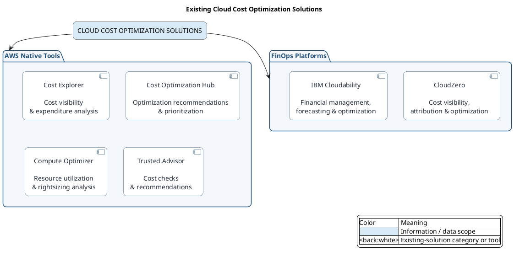
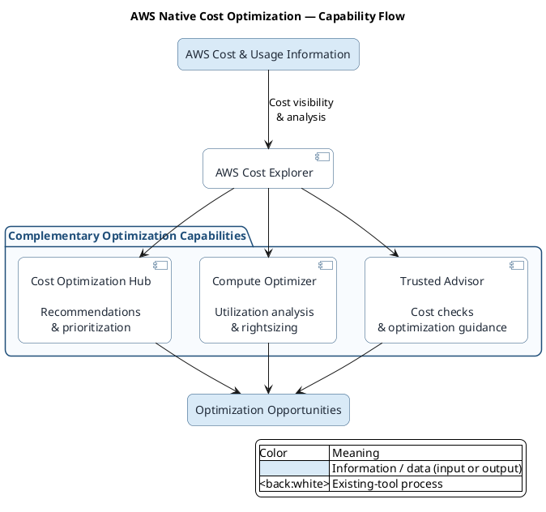
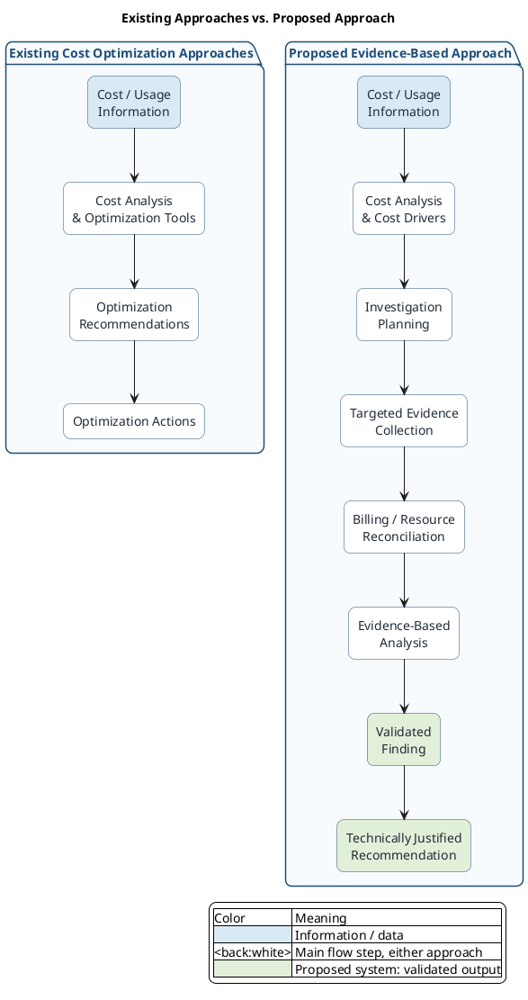
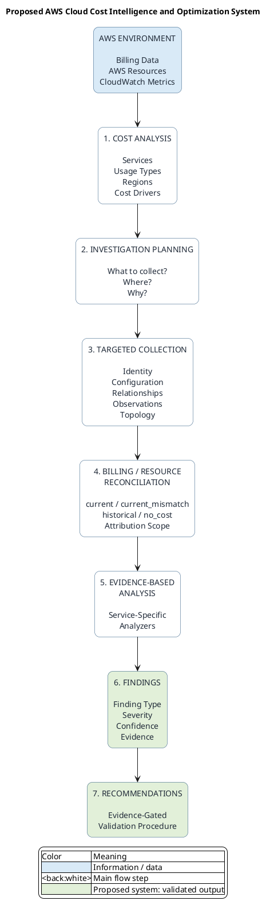
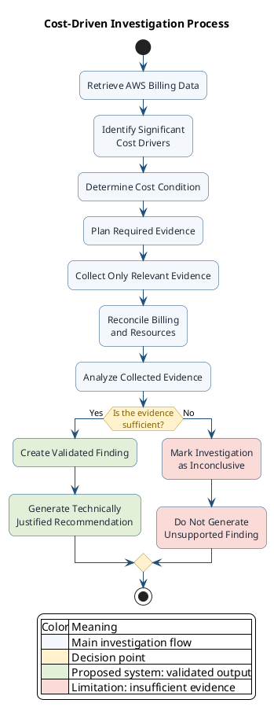
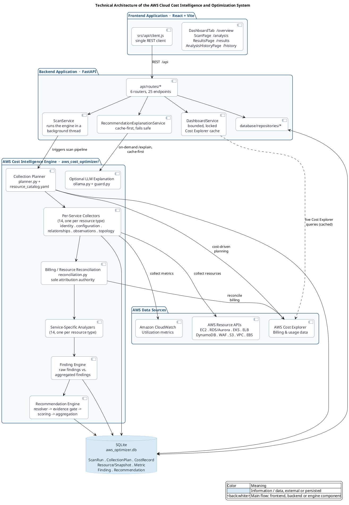

# Thesis Figures — PlantUML Source

Six figures for the thesis, corrected against the actual codebase
(`CLAUDE.md`, `docs/ARCHITECTURE.md`) and drawn with **one consistent
color convention** across all of them:

| Color | Hex | Meaning |
| --- | --- | --- |
| **Dark blue** | `#1F4E79` (border) | Main flow — a process or component, existing or proposed |
| **Light blue** | `#D9EAF7` fill / `#5B9BD5` border | Information / data — inputs, outputs, or things at rest |
| **Green** | `#E2F0D9` fill / `#70AD47` border | The proposed system's validated result — used **only** for this project's own findings/recommendations, never for an existing tool's output |
| **Orange** | `#FFF2CC` fill / `#BF9000` border | A decision point |
| **Red** | `#FADBD8` fill / `#C0392B` border | A limitation — the fail-closed / "insufficient evidence" path |

Two corrections from the original draft, applied throughout:

1. **Green was appearing on existing-tool outputs** (Figure 2's
   "Optimization Opportunities"). Green is reserved for *this project's*
   validated output, so existing-solution figures (1, 2, and the left
   half of 3) now stay dark-blue/light-blue only.
2. **Figure 6 didn't match the code.** File/module names, the evidence
   sections, the reconciliation statuses, and the endpoint/collector
   counts below are pulled directly from the current
   `aws_cost_optimizer/`, `backend/`, and `frontend/` trees, not the
   generic architecture from the earlier draft.

---

# Figure 1 — Existing Cost Optimization Solutions

**Placement:** Chapter I → Existing Solutions
**Caption:** *Figure X. Overview of Existing Cloud Cost Optimization Solutions*



Establishes two categories — **AWS Native Tools** and **FinOps
Platforms** — without ranking either. No project claim is made here, so
no green appears.

---

# Figure 2 — AWS Native Solutions: Capability Flow

**Placement:** Chapter I → AWS Native Cost Optimization Solutions
**Caption:** *Figure X. Complementary Roles of AWS Native Cost Optimization Tools*



Makes the point that the AWS tools are **complementary**, not unrelated
products. `RESULT` stays light blue, not green — it's an existing
tool's output, not this project's.

---

# Figure 3 — Existing Approaches vs. Proposed Approach

The most important conceptual figure in Chapter I.

**Placement:** After the comparison / before the identified gap
**Caption:** *Figure X. From Conventional Cost Optimization to Evidence-Based Investigation*



**Framing to use in the text:** don't claim existing systems *can't*
reconcile billing or collect evidence. Say instead that this project
places explicit emphasis on an **integrated investigation workflow**,
where cost analysis determines what evidence is collected next — that's
the real, defensible distinction the diagram is making.

---

# Figure 4 — Proposed Solution: Main System Workflow

**Placement:** Chapter II → 3.1 General Description
**Caption:** *Figure X. Overall Workflow of the Proposed AWS Cloud Cost Intelligence and Optimization System*



Step 3's evidence sections and step 4's reconciliation statuses now name
the actual five evidence categories and four reconciliation outcomes the
engine produces, instead of a generic paraphrase. Use this diagram to
**introduce the whole system**.

---

# Figure 5 — System Workflow: Decision Logic

For 3.3 System Workflow — deliberately different from Figure 4: this one
shows the **decision-making logic**, so it's the one figure where orange
(decision) and red (limitation) actually appear.

**Caption:** *Figure X. Detailed Workflow of the Cost-Driven Investigation Process*



This is the figure that visually establishes the project's **fail-closed
principle**:

```text
Insufficient Evidence
        v
   Inconclusive
        v
No Unsupported Finding
        v
No Unsupported Recommendation
```

---

# Figure 6 — Technical Architecture

**Placement:** Chapter II → 4.1 Overall Architecture
**Caption:** *Figure X. Technical Architecture of the AWS Cloud Cost Intelligence and Optimization System*

Rebuilt against the current codebase rather than a generic layered
sketch: real module names (`planner.py`, `reconciliation.py`,
`engine.py`), real counts (14 collectors, 14 analyzers, 6 API routers /
25 endpoints), and the real dependency direction — **Frontend → Backend
→ Cost Intelligence Engine → AWS**, with SQLite as the shared
persistence both the engine writes to and the backend reads from.



Green is deliberately absent here — it marks a *validated result*
(Figures 3–5), and an architecture diagram has no results, only
components. The dependency direction is explicit in the arrows
(`UI_CLIENT -> BE_ROUTES -> BE_SCAN -> CP -> ... -> AWS`), which is the
improvement worth keeping over a flatter, unordered box layout:

```text
        FRONTEND (React + Vite)
               |  REST
               v
        BACKEND (FastAPI)
          |            \
          v             v
   COST INTELLIGENCE   SQLite
       ENGINE      <----'  (read/write)
          |
          v
          AWS
```

---

## Recommended final set

| Figure | Report location | Purpose |
| --- | --- | --- |
| **1** | Existing Solutions | Existing ecosystem |
| **2** | AWS Native Solutions | Complementary AWS capabilities |
| **3** | Identified Gap | Existing vs. proposed investigation approach |
| **4** | 3.1 Proposed Solution | Overall system workflow |
| **5** | 3.3 System Workflow | Decision / fail-closed logic |
| **6** | 4.1 Overall Architecture | Actual technical architecture |

Figures 3, 4, 5, and 6 must not look like repetitions:

- **Figure 3** — why the approach is different
- **Figure 4** — what the system does
- **Figure 5** — how the system decides
- **Figure 6** — how the components are technically organized
